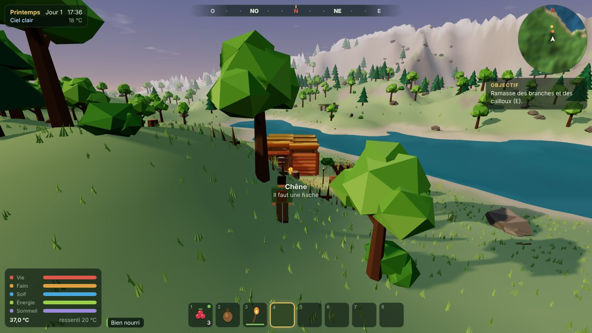
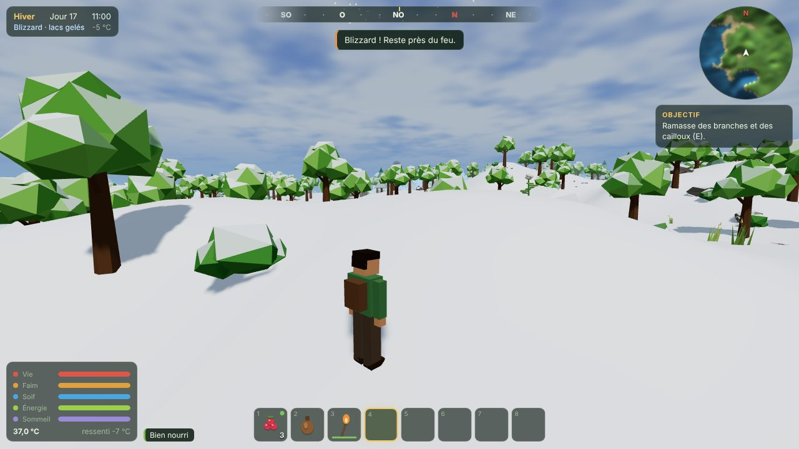
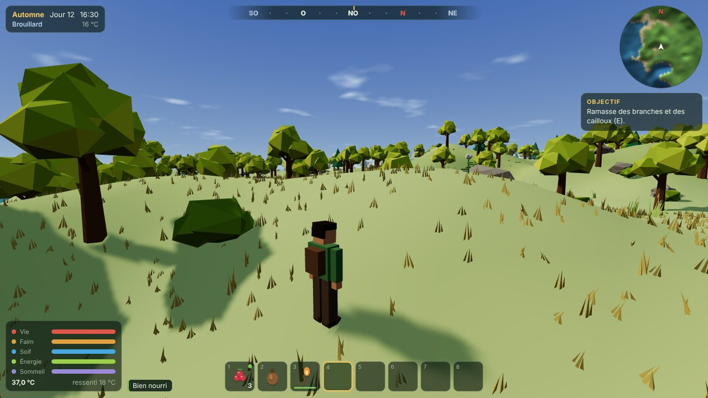
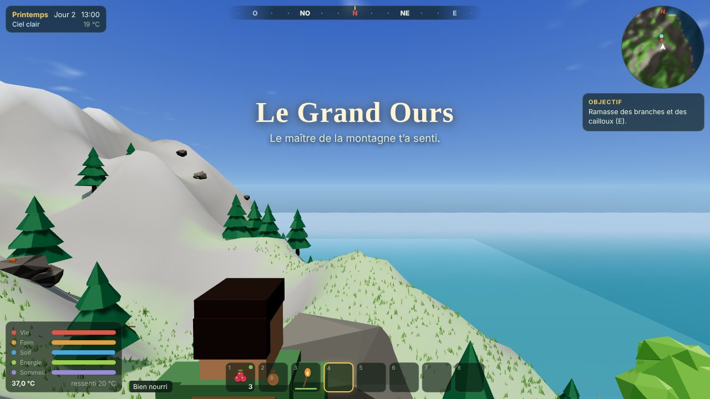
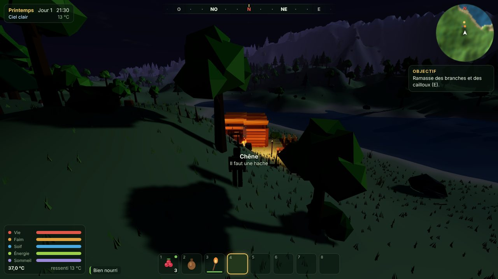
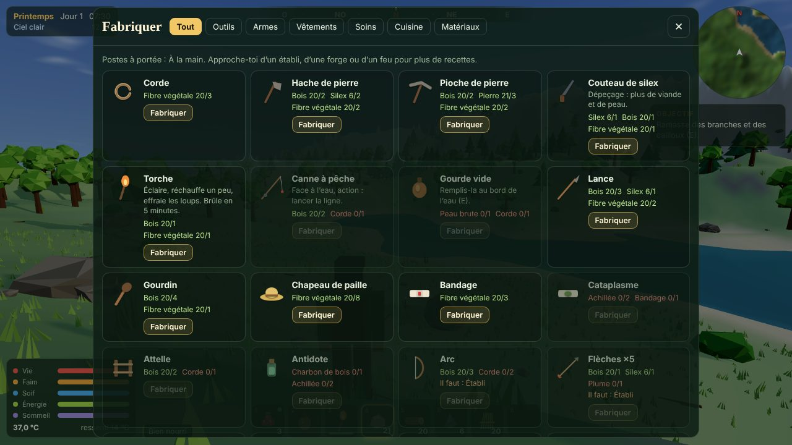
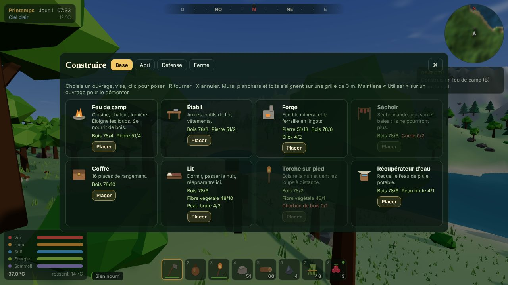
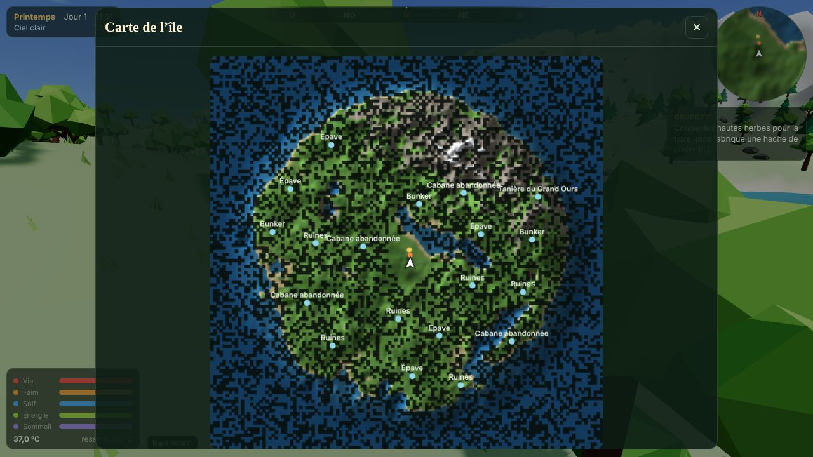
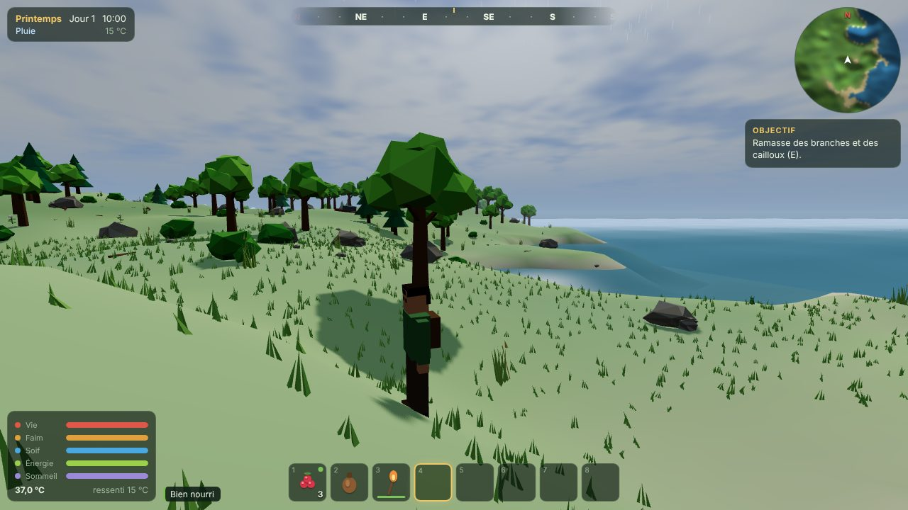
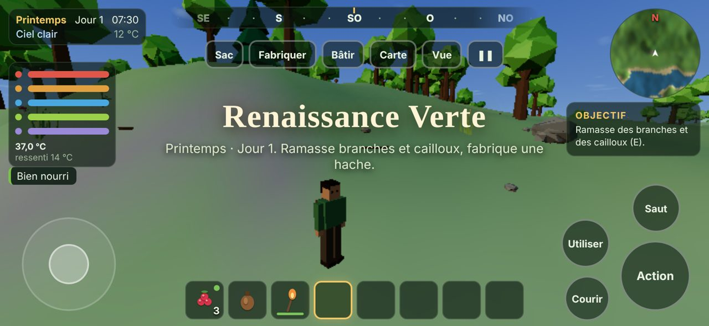

<p align="center"></p>

# 🌿 Renaissance Verte — 3.0

Un jeu de survie **en vraie 3D**. Tu te réveilles sur une île sauvage de 640 m, avec trois baies, une gourde vide et une torche. Il va falloir manger, boire, dormir, rester au chaud, soigner ses plaies, cultiver, cuisiner, se battre… et passer l'hiver.

Disponible en **application** pour **Windows, macOS, Linux et Android**.



| Hiver et blizzard | Automne | Le Grand Ours dans la montagne |
|---|---|---|
|  |  |  |
| **La nuit, près du feu** | **Fabriquer** | **Construire** |
|  |  |  |
| **La carte de l'île** | **Sous la pluie** | **Sur téléphone** |
|  |  |  |

---

## ✨ Ce qu'il y a dans le jeu

### Corps et santé
- **Vie, faim, soif, énergie, sommeil** — chaque jauge compte. Courir et nager fatiguent, la nuit blanche se paie.
- **Température du corps** — l'air, le vent, la pluie, la neige, l'eau, le feu, les vêtements et les toits jouent tous. Hypothermie l'hiver, coup de chaleur l'été.
- **Être mouillé** — la pluie et la baignade trempent, le feu sèche.
- **Blessures et maladies** — saignement, infection, fièvre, intoxication, poison, entorse, épuisement… Bandages, cataplasmes, antidotes et repos pour s'en remettre.
- **Mort** — tu te réveilles au camp, ton sac reste là où tu es tombé.

### Saisons et monde vivant
- **Quatre saisons** qui changent l'île : bourgeons, sécheresse et incendies l'été, feuillage roux en automne, neige et lacs gelés l'hiver.
- **Météo** — ciel clair, nuages, pluie, orage avec la foudre qui peut embraser un arbre, brouillard, blizzard, canicule. Crues après les grosses pluies.
- **Cycle jour / nuit**, soleil et lune, étoiles, nuages qui défilent, arbres qui ploient au vent.
- **Animaux** — lapins, cerfs, sangliers, loups, ours et poules. Ils fuient, chargent, rôdent, ont peur du feu.
- **Raids de loups** une nuit sur trois à partir du 3ᵉ jour, avec un **loup alpha** dès le 9ᵉ. Un **Grand Ours** garde sa tanière dans la montagne.
- **Lieux à découvrir** — 6 ruines, 4 cabanes, 5 épaves et **3 bunkers** cachés avec des plans rares (arbalète, plastron, lanterne).
- Les arbres repoussent et les incendies se propagent d'arbre en arbre.

### Ferme et cuisine
- **Potager** : carottes, blé, courges… à arroser, à protéger du gel, des crues et des nuisibles.
- **Poulailler** : apprivoise les poules en les nourrissant, ramasse les œufs.
- **Récupérateur d'eau**, **séchoir** pour la viande et le poisson, **pêche** à la canne.
- **Cuisine** au feu de camp : grillades, ragoûts, soupes, pain… La nourriture **pourrit** avec le temps ; le séchage la garde.
- **Champignons** : le cèpe nourrit, l'amanite empoisonne.

### Équipement et combat
- **Outils** : hache, pioche, couteau (meilleur dépeçage), canne à pêche, torche, gourde.
- **Armes** : gourdin, lance, arc, arbalète et flèches qui volent vraiment.
- **Armures et vêtements** sur trois emplacements (tête, corps, jambes) : protection et chaleur. Les objets **s'usent**.
- **Établi** et **forge** pour monter en gamme (fer, lingots).
- **Construction** sur une grille de 3 m : murs, portes, sols, toits, lit, coffre, feu, pieux, palissades… On démonte en maintenant `E`.

### Pour bien démarrer
15 **objectifs guidés** t'accompagnent (ramasser, fabriquer une hache, allumer un feu, dormir, construire un abri…). La partie se **sauvegarde automatiquement**. Trois difficultés : **Paisible**, **Normal**, **Rude**.

---

## 💾 Installer l'application

👉 **[Télécharger les applis](https://github.com/ck526438-lgtm/renaissance-verte/releases)** — ouvre la release *Renaissance Verte 3.0 (bêta)* (ou la plus récente), section **Assets**, et choisis le fichier de ton système. Pas besoin de compte GitHub.

| Système | Fichier | Installation |
|---|---|---|
| **Windows** | `Renaissance-Verte-3.0.0-win-x64.exe` | Double-clic, choisis le dossier ; raccourci sur le bureau et dans le menu Démarrer. Si Windows affiche « Windows a protégé votre ordinateur » (appli non signée) : *Informations complémentaires* → *Exécuter quand même*. |
| **Windows (sans installer)** | `Renaissance-Verte-3.0.0-portable.exe` | Se lance directement, même depuis une clé USB. |
| **macOS** (Intel et Apple Silicon) | `Renaissance-Verte-3.0.0-mac-….dmg` | Ouvre le `.dmg`, glisse l'appli dans *Applications*. Premier lancement : clic droit → *Ouvrir*. |
| **Linux** | `….AppImage` ou `….deb` | `chmod +x *.AppImage` puis double-clic — ou `sudo apt install ./Renaissance-Verte-*.deb`. |
| **Android** (7.0 et plus) | `Renaissance-Verte-3.0.0-android.apk` | Copie l'APK sur le téléphone et ouvre-le. Autorise « Installer des applis inconnues » pour ton navigateur ou ton gestionnaire de fichiers. Le jeu se lance en paysage, plein écran. |

Sur ordinateur : `F11` ou `Alt+Entrée` pour le plein écran.

---

## 🎮 Commandes

**Clavier et souris** (QWERTY et AZERTY reconnus : `ZQSD` marche aussi)

| Touche | Action |
|---|---|
| `W A S D` / `Z Q S D` / flèches | Se déplacer |
| Souris | Regarder (clic dans la fenêtre pour capturer la souris) |
| Clic gauche | Action : frapper, couper, miner, tirer, poser |
| `E` ou `F` | Utiliser / ramasser · **maintenir** pour démonter |
| `Espace` | Sauter / nager vers le haut |
| `Maj` | Courir |
| `1` – `8`, molette | Barre rapide |
| `Tab` ou `I` | Sac et équipement |
| `C` | Fabriquer |
| `B` | Construire · `R` pour tourner · `X` pour annuler |
| `M` | Carte |
| `G` | Lâcher l'objet en main |
| `V` | Vue 1ʳᵉ / 3ᵉ personne |
| `H` | Guide |
| `Échap` ou `P` | Pause |

**Manette** : stick gauche pour bouger, stick droit pour regarder, `X` ou gâchette droite pour l'action, `A` pour sauter, `B` pour utiliser, `Y` pour le sac, `LB`/`RB` pour la barre rapide, croix pour construire, fabriquer et lâcher, `Start` pour la pause.

**Tactile (Android)** : joystick à gauche, glisser à droite pour regarder, boutons *Action*, *Utiliser*, *Saut*, *Courir* et une barre en haut (*Sac*, *Fabriquer*, *Bâtir*, *Carte*, *Vue*, pause). Le bouton *Retour* d'Android met en pause.

---

## 🛠️ Construire soi-même

Il faut **Node.js 20+** (et pour Android : **JDK 21** + **Android SDK**).

```bash
npm install
npm run dev          # jouer dans le navigateur (http://localhost:5173)
npm start            # lancer l'appli de bureau
npm run dist:win     # installateur Windows (sous Windows)
npm run dist:mac     # .dmg (sous macOS)
npm run dist:linux   # AppImage + .deb
npm run android:apk  # APK Android → android/app/build/outputs/apk/debug/
```

Les fichiers produits arrivent dans `release/` (bureau).

## 🧪 Sous le capot

- **Three.js** pour la 3D (ombres dynamiques, végétation instanciée par tronçons, shaders de saison, de vent et de neige, eau animée, ciel dessiné), **Vite** pour l'assemblage.
- **Electron** pour Windows, macOS et Linux, **Capacitor** pour Android.
- Sons et musique **générés en direct** (WebAudio), aucune ressource externe.
- Réglages graphiques **Bas / Moyen / Haut** et distance de vue, choisis automatiquement selon l'appareil.

## 📁 Contenu du dépôt

| Dossier | Rôle |
|---|---|
| `index.html`, `src/` | Le jeu 3D (`core/` moteur, `world/` île et météo, `entities/` joueur et animaux, `game/` survie, objets, recettes, constructions, `ui/` interface) |
| `public/` | Logo et icônes |
| `desktop/` | Fenêtre Electron (bureau) |
| `android/` | Projet Android (Capacitor) |
| `build/` | Icône des installateurs |
| `.github/workflows/build.yml` | Fabrique les applis pour les 4 systèmes |
| `legacy-2d/` | L'ancienne version 2D (2.0), toujours jouable en ouvrant `legacy-2d/index.html` |
| `media/` | Captures d'écran |

## Licence

Tous droits réservés.
