<p align="center">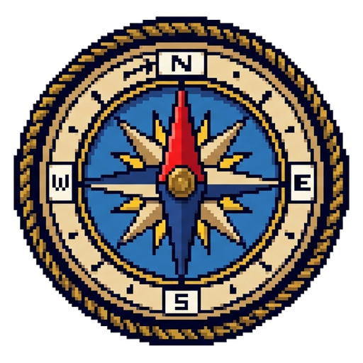</p>

# 🌿 Renaissance Verte

Un mini-jeu de survie **pixel**, jouable en double-cliquant sur `index.html`. Le monde est fini, la végétation a repris les villes, et il ne reste que des traces dorées de ceux qui ont survécu. Toi, tu coupes, tu casses, tu pêches, tu chasses, tu construis — et tu leur réponds **dans leur langue**. Ramène-les au camp : ils apprendront à te faire confiance, à marchander avec toi, à se mettre en couple et à faire des enfants qui, un jour, reprendront la pioche.

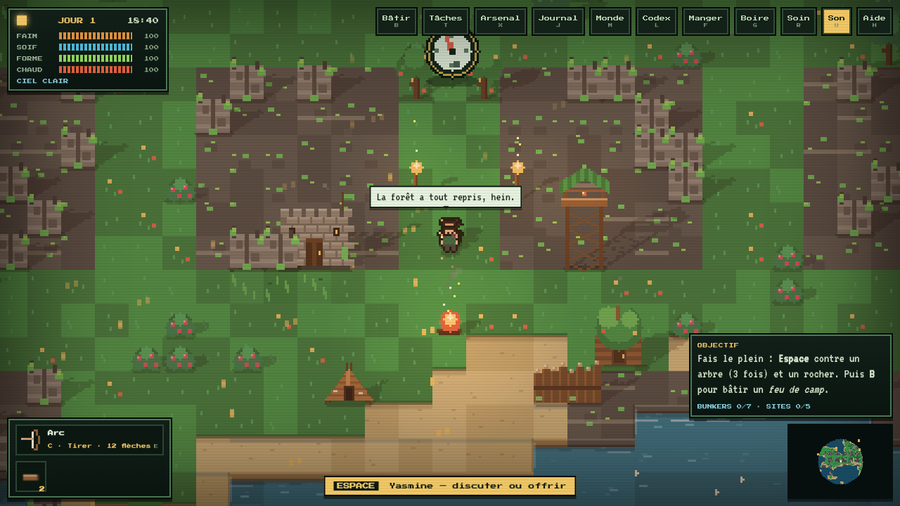

---

## ✨ Nouveau dans la 2.0

| Relief 2.5D : ombres qui tournent avec le soleil, rives en surplomb, eau profonde | Bunkers enfouis : lumière à rallumer, terminaux, râteliers | Sites perdus du monde d'avant |
|---|---|---|
| 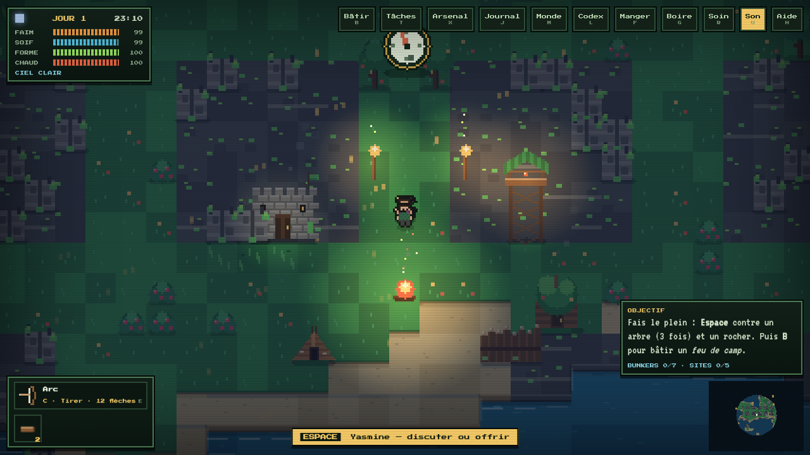 | 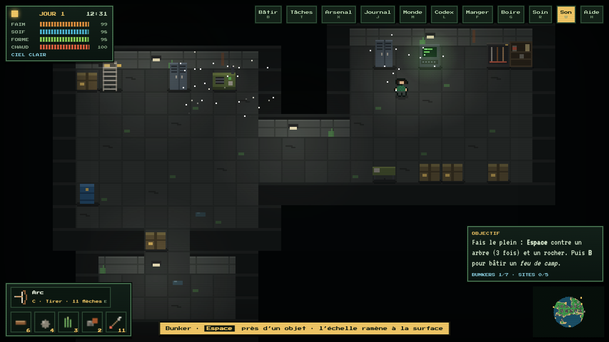 | 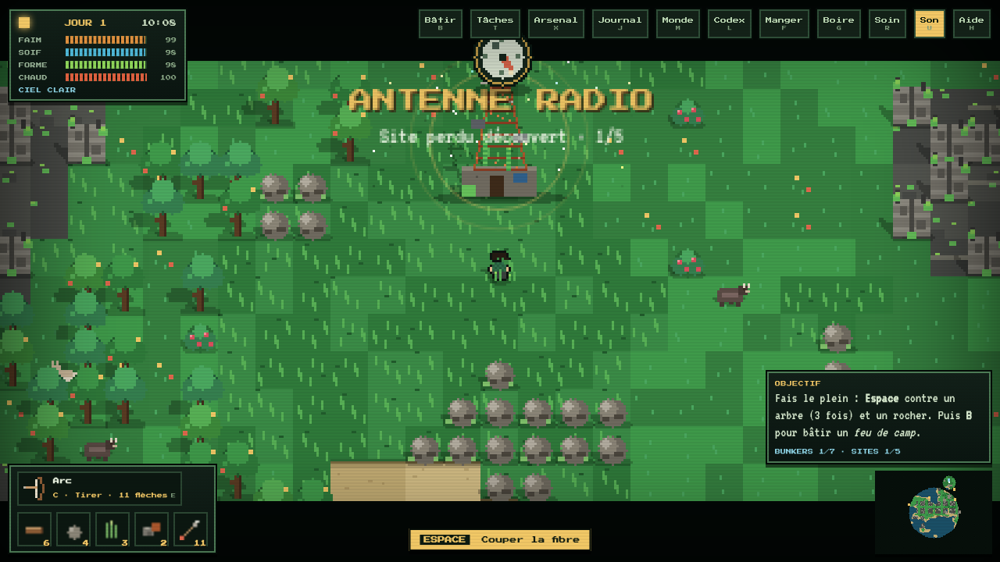 |

| Les loups de la nuit, l'arc à la main | L'orage, la pluie, la brume | L'esprit des survivants |
|---|---|---|
| 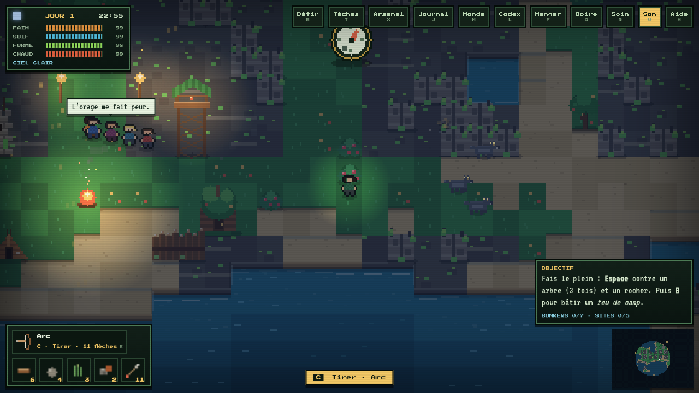 | 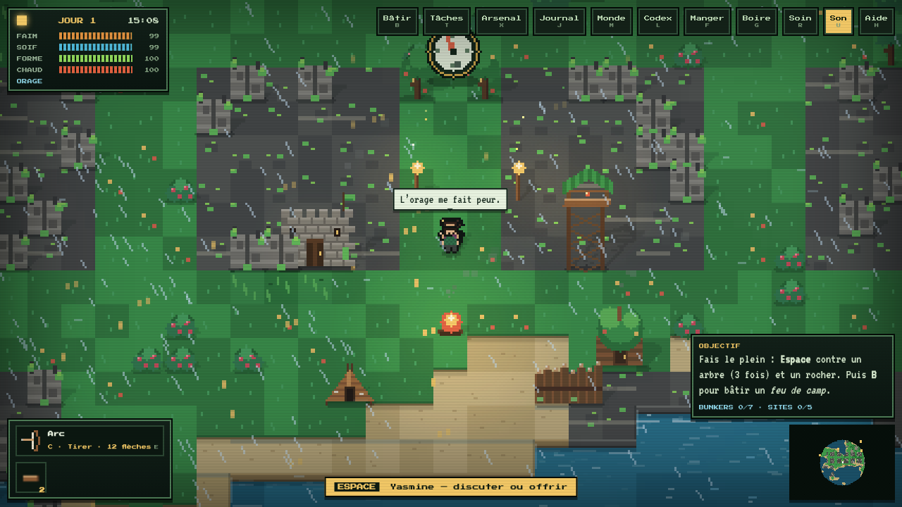 | 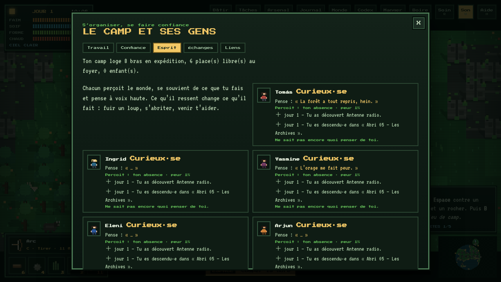 |

- **Relief 2.5D** — chaque arbre, rocher, abri et personnage projette une vraie ombre qui s'allonge le matin et le soir et tourne avec le soleil. Les rives surplombent l'eau, l'herbe passe devant les jambes, la mer fonce avec la profondeur, les arbres plient au vent, l'ombre des nuages glisse sur le pays et des vols d'oiseaux passent au-dessus.
- **Animations hors du commun** — l'arbre coupé tombe et s'écrase dans une gerbe de feuilles, la roche éclate en éclats et étincelles, les braises et la fumée montent du feu et dérivent au vent, lucioles la nuit, éclaboussures, poisson qui saute, ouvrages qui sortent de terre, tremblements d'écran, bandeaux de cinéma pour les grandes découvertes, lumière chaude et colorée la nuit.
- **Météo** — ciel clair, grand vent, pluie, orage avec éclairs et tonnerre, brume du matin. La pluie refroidit loin des toits mais remplit les collecteurs.
- **7 bunkers enfouis** — des trappes d'acier cachées sous la mousse : un éclat doré en trahit une de temps en temps, le **détecteur** bipe à l'approche. Force-les à mains nues ou au **pied-de-biche**, descends, rallume le **groupe électrogène** avec une pile, fouille caisses, casiers et étagères, lis le **terminal** (il donne la position d'un site) et ouvre le **râtelier** : machette, lanterne, arc, détecteur, plans, arbalète…
- **5 sites perdus** — observatoire effondré, gare engloutie, serre-temple, antenne radio, bibliothèque noyée. Chacun garde une **relique** : la lunette qui révèle les trappes, le plan d'arbalète, les graines anciennes, la radio météo, le plan du fortin.
- **Arsenal** (`X`) — gourdin, hache de silex (coupe ×2), machette, pied-de-biche, sagaie, fronde (pierres), arc et arbalète (flèches). Tirs en cloche avec ombre au sol, coups au corps à corps avec traînée, dégâts affichés. `C` attaque, `E` change d'arme, `R` se soigne.
- **Les loups** — la nuit, loin du feu, ils chassent : toi, ou un survivant isolé. Le feu, les torches, le fortin et la tour les tiennent à distance.
- **Nouveaux abris** — tente de peau, palissade de pieux, cabane sur pilotis (sur le sable), tour de guet (révèle le pays) et fortin de pierre (le plus grand toit).
- **La conscience des survivants** — chacun **perçoit** (un loup qui approche, la pluie, le noir, ta fatigue), **ressent** (peur, gratitude, curiosité), **se souvient** de ce que tu fais (un repas offert, un loup abattu près de lui, un bunker exploré) et **pense à voix haute** dans des bulles. Il agit en conséquence : fuir vers le feu, crier où est le loup, s'abriter de la pluie, le chasseur qui affronte le loup, venir te tendre à manger quand tu tiens à peine debout. Rentre au camp après une découverte : tu la racontes au coin du feu. Nouvel onglet **Esprit** dans le panneau `T`.
- **Journal d'exploration** (`J`) — la carte du territoire déjà parcouru (le reste est dans le brouillard), les bunkers, les sites, les reliques et les archives lues.
- **Une vraie appli** — installateur Windows, version portable, macOS et Linux (voir plus bas).

---

## 💾 L'installer (Windows · macOS · Linux)

Les installateurs sont construits automatiquement par GitHub Actions et publiés dans les **[Releases](https://github.com/ck526438-lgtm/renaissance-verte/releases)** à chaque version (`v2.0.0`, …).

| Système | Fichier | Installation |
|---|---|---|
| **Windows** | `Renaissance-Verte-…-win-x64.exe` | Double-clic, choisis le dossier ; un raccourci arrive sur le bureau et dans le menu Démarrer. Windows peut afficher « Windows a protégé votre ordinateur » (appli non signée) : *Informations complémentaires* → *Exécuter quand même*. |
| **Windows (sans installer)** | `Renaissance-Verte-…-portable.exe` | Se lance directement, même depuis une clé USB. |
| **macOS** (Intel et Apple Silicon) | `Renaissance-Verte-…-mac-….dmg` | Ouvre le `.dmg`, glisse l'appli dans *Applications*. Premier lancement : clic droit → *Ouvrir* (appli non signée). |
| **Linux** | `….AppImage` ou `….deb` | `chmod +x *.AppImage` puis double-clic — ou `sudo apt install ./Renaissance-Verte-*.deb`. |

Dans l'appli : `F11` (ou `Alt+Entrée`) bascule en plein écran. La sauvegarde reste sur la machine.

**Construire soi-même** (Node.js 20+) :

```bash
npm install
npm start            # lance le jeu dans sa fenêtre
npm run dist:win     # installateur Windows (à lancer sous Windows)
npm run dist:mac     # .dmg (sous macOS)
npm run dist:linux   # AppImage + .deb
```

## ▶️ Y jouer sans rien installer

Aucune dépendance, aucun serveur. Le jeu tient dans **un seul fichier** : [`index.html`](index.html).

| Système | Ce qu'il faut faire |
|---|---|
| **Windows** | `index.html` → clic droit → *Ouvrir avec* → Chrome, Edge ou Firefox |
| **macOS** | `index.html` → double-clic (Safari fonctionne, Chrome encore mieux) |
| **Linux** | `index.html` → double-clic avec le navigateur par défaut, ou `firefox index.html` |
| **Cloner** | `git clone https://github.com/ck526438-lgtm/renaissance-verte.git` puis ouvrir le fichier |
| **Télécharger** | *Code ▸ Download ZIP*, dézipper, ouvrir `index.html` |

> Clavier AZERTY ou QWERTY, souris ou écran tactile : les boutons du HUD font tout, le clavier n'est qu'un raccourci. La sauvegarde vit dans le `localStorage` du navigateur.

---

## 🎬 Ça bouge, ça se mange, ça se construit

| Chasser à la sagaie | Le camp travaille pendant que tu explores | Prendre le large au radeau |
|---|---|---|
| 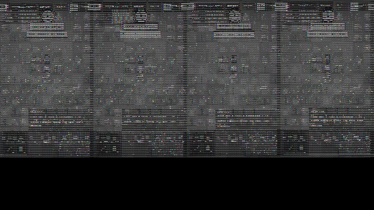 | 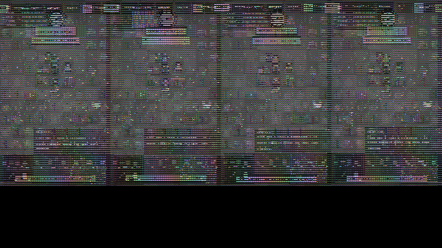 | 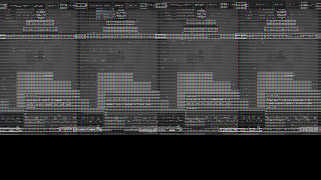 |

| La vie du camp : bulles, troc, gamins qui courent entre les maisons |
|---|
| 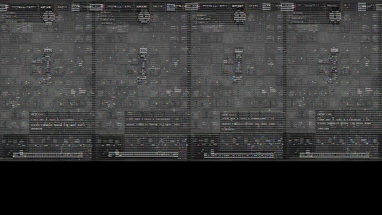 |

---

## 🧰 Ce que le jeu sait faire

- **Survivre vraiment** — faim, soif, énergie, chaleur ; un cycle jour/nuit complet qui fait vraiment froid la nuit, surtout sur l'eau.
- **Récolter le monde** — couper les arbres (bois + feuilles), casser les rochers (pierre, silex), fouiller les hautes herbes (fibre), cueillir les baies.
- **Construire des logements** — feu de camp, établi, abri, lit, coffre, torche, mur et surtout la **maison de branchage**, qui donne des toits et donc une caravane plus nombreuse. Le toit compte aussi pour le **foyer** : sans place libre, personne ne se met en couple et aucun enfant ne naît au camp.
- **Se partager les tâches** — touche `T` : chaque survivant du camp devient bûcheron, carrier, cueilleur, pêcheur ou chasseur. Leur récolte s'empile et tombe dans ton sac quand tu reviens près du feu. Le même panneau a quatre onglets : *Travail*, *Confiance*, *Échanges*, *Liens*.
- **Chasser** — lapins, chevreuils et sangliers peuplent les herbes hautes, fuient à ton approche. La sagaie vise toute seule ; le **piège à lacet** se remplit pendant la nuit.
- **Naviguer** — le radeau de pêche se pose sur l'eau, on monte, on accoste, et au large la jauge est plus large et le poisson deux fois plus généreux.
- **Une vraie IA de camp** — chaque survivant a une **confiance** qui monte et descend (Méfiant ▸ Prudent ▸ Estimé ▸ Complice ▸ Indispensable), quatre besoins (faim, soif, repos, moral) et une humeur qui en découle. Il choisit seul ce qui l'appelle : aller chercher à manger, trouver l’eau, dormir au chaud, discuter avec un voisin ou venir te proposer un marché.
- **Échanger avec eux** — onglet *Échanges* du panneau `T` : chacun étale son stock du jour et fixe son prix. Un marché tenu rapporte du matériel **et** de la confiance ; offrir sans rien demander en rapporte encore plus. Au-dessus de 74, le tarif tombe et le cadeau grossit.
- **Se lier, fonder un foyer** — les voisins discutent entre eux et tissent des liens qui grimpent à force de partager le feu et le toit. Deux liés assez solides deviennent un **couple**, et un couple qui mange à sa faim dans une maison assez grande fait un **enfant**. Le gamin grandit : berceau, enfant, adolescent, puis adulte qui reprend une pioche au matin.
- **Neuf langues du monde** — portugais, norvégien, arabe (de droite à gauche), grec, hindi, swahili, turc, japonais, islandais. Chaque voyageur parle, translittère et explique un mot ; le carnet de langues garde ce que tu as appris.
- **Une carte du monde procédurale** — 140 × 100 carreaux générés depuis une graine, ruines englouties sous la mousse, régrown, empreintes dorées, boussole d'étoiles.
- **Une fin** — un épilogue noté sur 27 étoiles selon tes jours, tes constructions, tes voix sauvées — et le foyer que tu as laissé derrière toi (couples formés, enfants nés au camp).

---

## 🖼️ Le monde en images

<table>
<tr>
<td width="50%">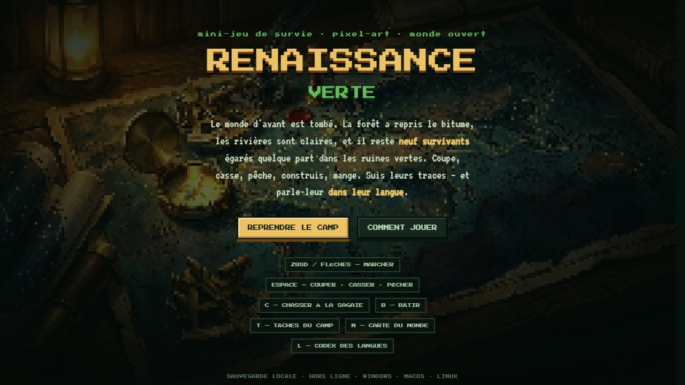</td>
<td width="50%">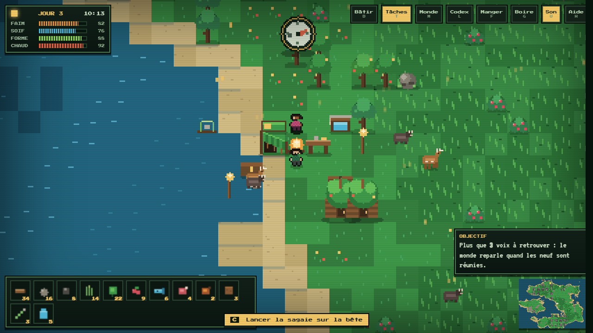</td>
</tr>
<tr>
<td>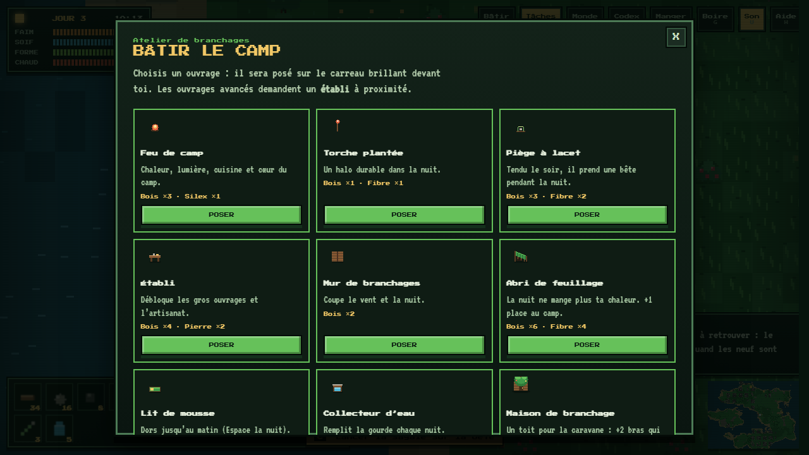</td>
<td>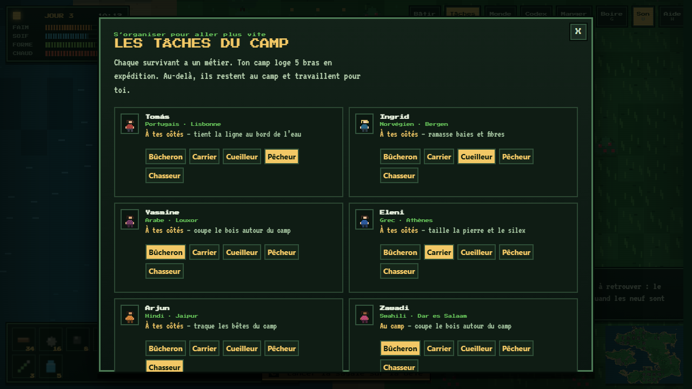</td>
</tr>
<tr>
<td>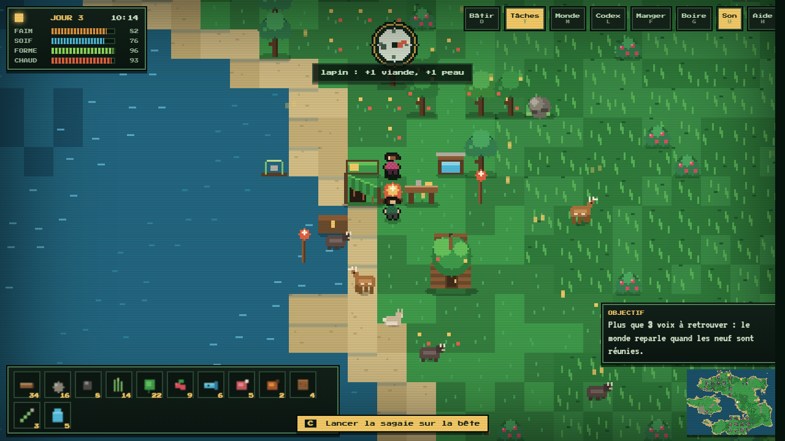</td>
<td>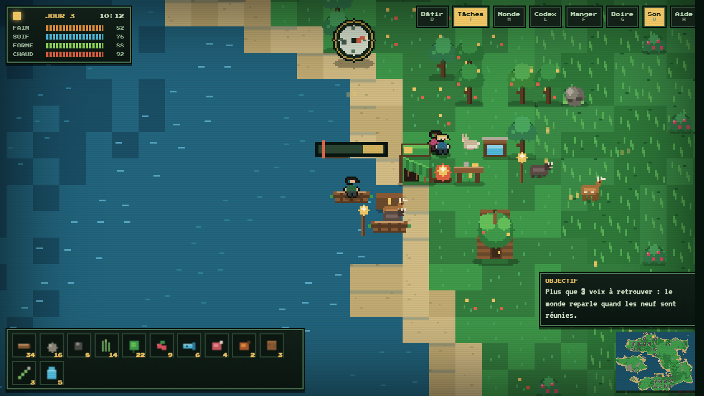</td>
</tr>
<tr>
<td>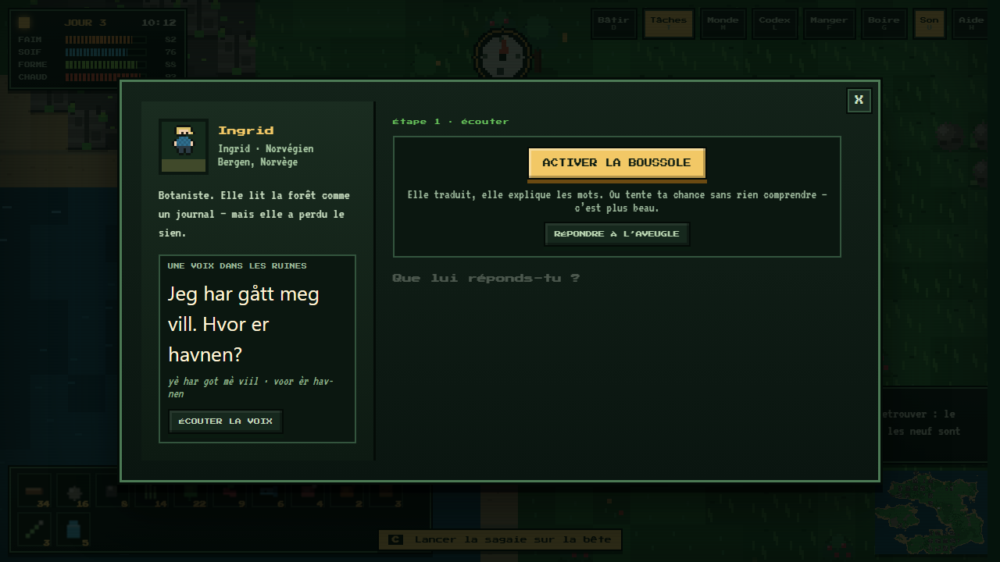</td>
<td>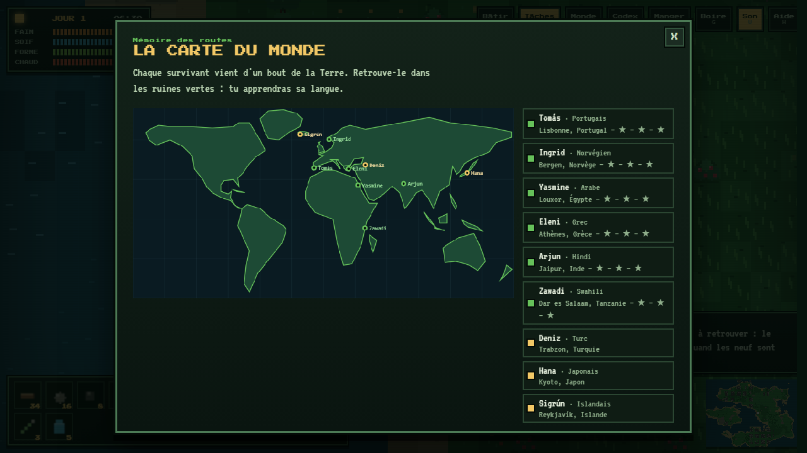</td>
</tr>
<tr>
<td>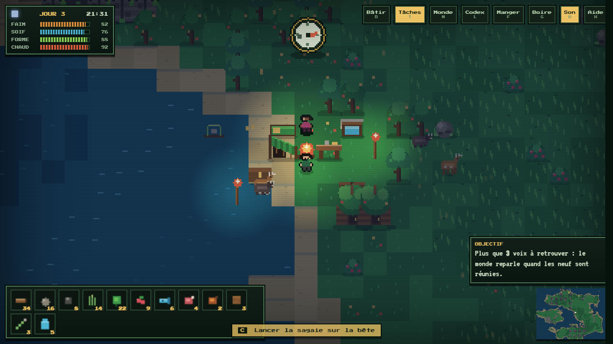</td>
<td>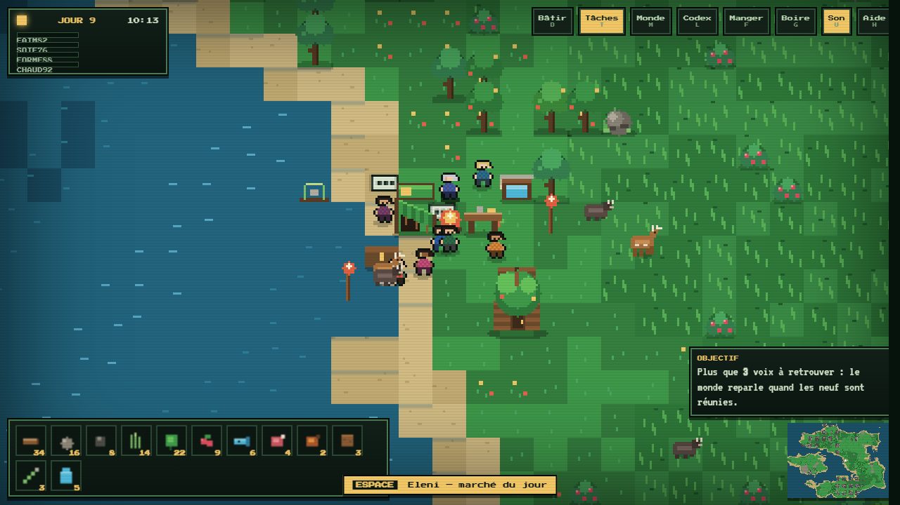</td>
</tr>
<tr>
<td>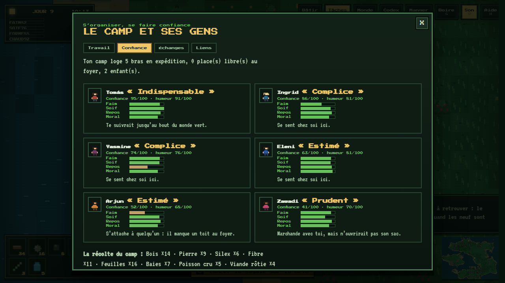</td>
<td>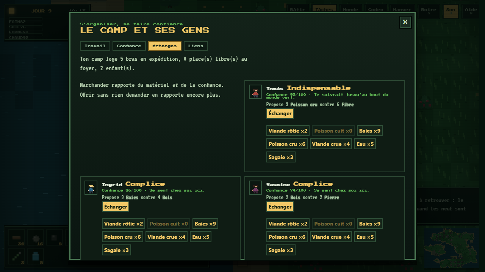</td>
</tr>
<tr>
<td>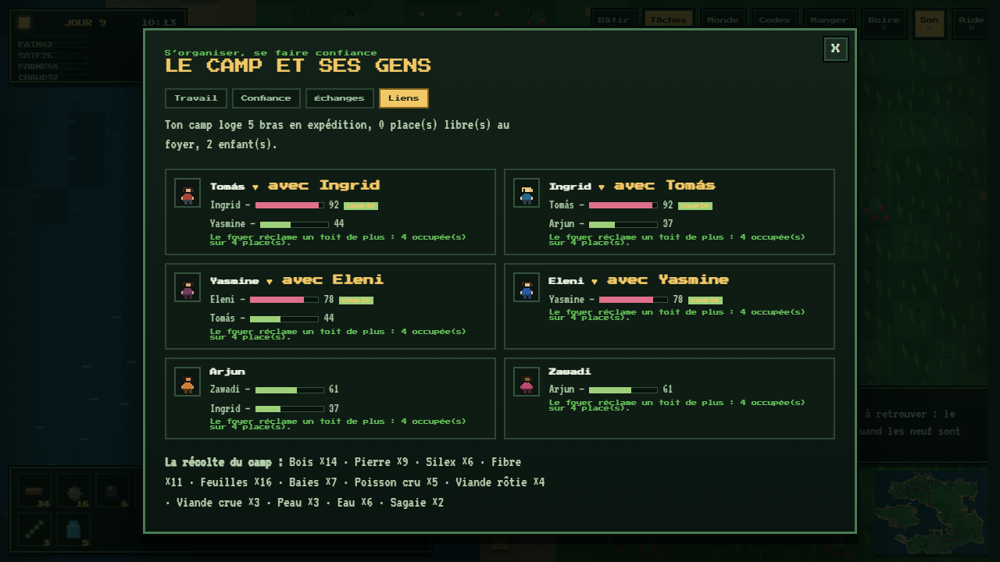</td>
<td></td>
</tr>
</table>

---

## ⌨️ Commandes

| Touche | Action | Bouton HUD |
|---|---|---|
| `↑ ↓ ← →` ou `Z Q S D` | marcher, nager, gouverner le radeau | croix tactile |
| `Espace` | couper · casser · cueillir · pêcher · monter ou accoster · forcer une trappe, descendre, fouiller · **ouvrir le marché du jour** auprès d'un survivant | **AGIR** |
| `C` | attaquer avec l'arme en main (visée automatique sur la bête la plus proche) | **Attaque** |
| `E` | changer d'arme | case de l'arme |
| `X` | l'arsenal : fabriquer, équiper | **Arsenal** |
| `J` | journal d'exploration et carte du territoire | **Journal** |
| `R` | utiliser une trousse de soins | **Soin** |
| `B` | ouvrir le chantier | **Construire** |
| `T` | la caravane : tâches, confiance, esprit, échanges, liens | **Tâches** |
| `M` | carte du monde | **Carte** |
| `L` | carnet des langues | **Carnet** |
| `F` / `G` | manger le meilleur de la réserve / boire | **Manger** · **Boire** |
| `H` | aide-mémoire de survie | **Aide** |
| `U` | sons | **Son** |
| `Échap` | fermer un panneau, annuler un chantier | — |

---

## 🧪 Sous le capot

- **Relief 2.5D sans moteur 3D** : les ombres sont des silhouettes des sprites projetées par une transformation affine (cisaillement + écrasement) qui suit l'heure, composées dans un calque unique pour ne jamais se doubler ; profondeur de l'eau précalculée par distance à la terre ; particules avec hauteur `z`, gravité, rebond et ombre au sol.
- **Bunkers** : chaque intérieur est généré depuis la graine du monde et le numéro de la trappe (salles, couloirs, butin), seuls les gestes du joueur sont sauvegardés.
- **Conscience des PNJ** : une boucle perception → sentiment → élan qui passe avant l'IA à élans existante, plus une mémoire courte d'événements datés et pondérés qui nourrit leurs pensées et leur avis sur toi.
- **Un seul fichier** : `index.html` ≈ 4 900 lignes de HTML, CSS et JavaScript vanilla, polices comprises. Zéro build, zéro framework, zéro image externe, zéro appel réseau : les deux polices pixel (*Press Start 2P* de CodeMan38 et *VT323* de Peter Hull, Open Font License) sont embarquées en base64 dans le fichier. Débranche le Wi-Fi, le jeu tourne quand même.
- **Monde procédural** : bruit de valeur + `mulberry32` sur une graine, terrains et objets dans des `typed arrays`, rendu des carreaux sales uniquement (`dirty` map) et repousse de la végétation suivie par `regrowSet`.
- **IA de camp** : les ouvriers choisissent une cible atteignable, contournent les obstacles, mémorisent les carreaux bloquants, se téléportent s'ils restent coincés de l'autre côté d'un bras de mer.
- **IA sociale à élans** : chaque PNJ calcule une note d'utilité par envie (`manger`, `boire`, `dormir`, `causer`, `troc`, `travail`, `suivre`) pondérée par ses besoins, sa confiance et la distance, puis part à l'action. La recherche d'eau fait un cercle croissant autour de lui, garde en mémoire les rives déjà essayées et renonce au bout de dix tours ; les élans à haut rendement (le marché, par exemple) ont une cooldown pour ne pas vider le poste de travail. Tout le monde se déplace avec le même `followWalk` que les ouvriers, et rien de l'état social ne sort d'un `localStorage` sauvegardé champ par champ — une vieille sauvegarde du jeu migre sans perdre ses neuf voix.
- **Animaux sans entités** : 26 bêtes simulées dans une liste plate avec errance, fuite et file de réapparition — rien à sauvegarder d'autre qu'une position et une espèce.
- **Échelle pixel propre** : le canvas interne vaut la taille de la fenêtre divisée par 3 (par 2 sur petit écran), chaque pixel de jeu occupant 3 px à l'écran avec `image-rendering: pixelated` — net du 1366 × 768 au 4K, et jouable en portrait sur téléphone.

---

## 📁 Contenu du dépôt

```
index.html                  le jeu, à lui tout seul
assets/                     logo et image de vitrine
media/                      captures d'écran et GIF (générés depuis le jeu, sans retouche)
desktop/main.js             la fenêtre de l'appli de bureau (Electron)
build/icon.png              icône des installateurs
package.json                construction des installateurs (electron-builder)
.github/workflows/build.yml installateurs Windows, macOS et Linux à chaque version
README.md                   ce fichier
```

---

## 🛠️ Licence

Projet personnel de démonstration. Tu peux jouer, copier, t'amuser et t'en inspirer librement ; aucune licence formelle n'a encore été choisie pour la redistribution commerciale.
