# 🌿 Renaissance Verte

Un mini-jeu de survie **pixel**, jouable en double-cliquant sur `index.html`. Le monde est fini, la végétation a repris les villes, et il ne reste que des traces dorées de ceux qui ont survécu. Toi, tu coupes, tu casses, tu pêches, tu chasses, tu construis — et tu leur réponds **dans leur langue**.

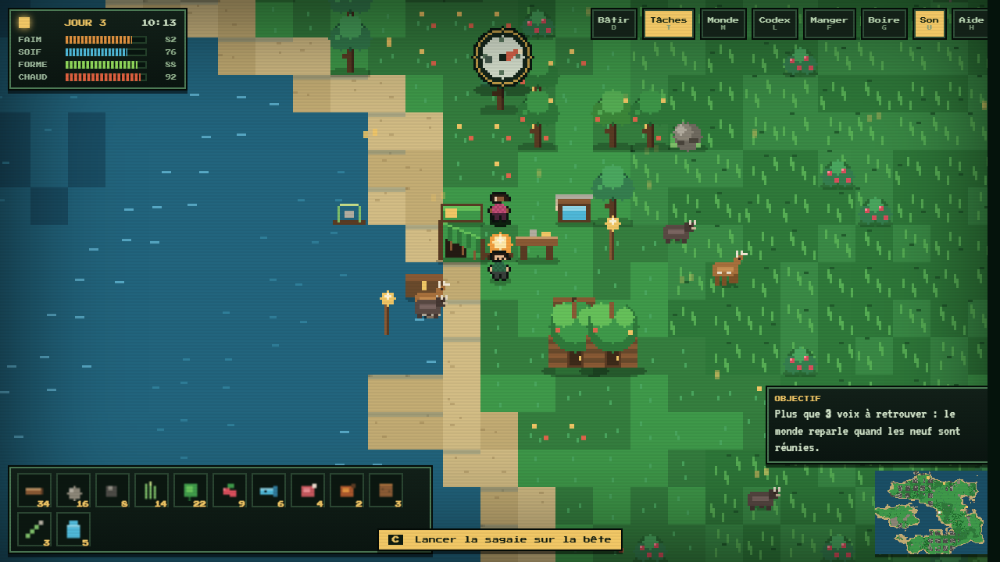

---

## ▶️ Y jouer (Windows · Linux · Mac)

Aucune installation, aucune dépendance, aucun serveur. Le jeu tient dans **un seul fichier** : [`index.html`](index.html).

| Système | Ce qu'il faut faire |
|---|---|
| **Windows** | `index.html` → clic droit → *Ouvrir avec* → Chrome, Edge ou Firefox |
| **macOS** | `index.html` → double-clic (Safari fonctionne, Chrome encore mieux) |
| **Linux** | `index.html` → double-clic avec le navigateur par défaut, ou `firefox index.html` |
| **Cloner** | `git clone https://github.com/ck526438-lgtm/renaissance-verte.git` puis ouvrir le fichier |
| **Télécharger** | *Code ▸ Download ZIP*, dézipper, ouvrir `index.html` |

> Clavier AZERTY ou QWERTY, souris ou écran tactile : les boutons du HUD font tout, le clavier n'est qu'un raccourci. La sauvegarde vit dans le `localStorage` du navigateur.

---

## 🎬 Ça bouge, ça se mange, ça se construit

| Chasser à la sagaie | Le camp travaille pendant que tu explores | Prendre le large au radeau |
|---|---|---|
| 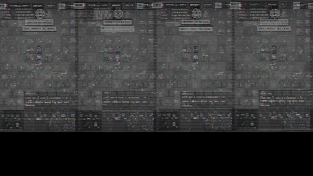 | 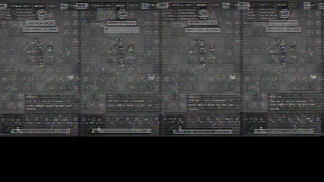 | 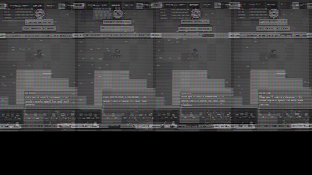 |

---

## 🧰 Ce que le jeu sait faire

- **Survivre vraiment** — faim, soif, énergie, chaleur ; un cycle jour/nuit complet qui fait vraiment froid la nuit, surtout sur l'eau.
- **Récolter le monde** — couper les arbres (bois + feuilles), casser les rochers (pierre, silex), fouiller les hautes herbes (fibre), cueillir les baies.
- **Construire des logements** — feu de camp, établi, abri, lit, coffre, torche, mur et surtout la **maison de branchage**, qui donne des toits et donc une caravane plus nombreuse.
- **Se partager les tâches** — touche `T` : chaque survivant du camp devient bûcheron, carrier, cueilleur, pêcheur ou chasseur. Leur récolte s'empile et tombe dans ton sac quand tu reviens près du feu.
- **Chasser** — lapins, chevreuils et sangliers peuplent les herbes hautes, fuient à ton approche. La sagaie vise toute seule ; le **piège à lacet** se remplit pendant la nuit.
- **Naviguer** — le radeau de pêche se pose sur l'eau, on monte, on accoste, et au large la jauge est plus large et le poisson deux fois plus généreux.
- **Neuf langues du monde** — portugais, norvégien, arabe (de droite à gauche), grec, hindi, swahili, turc, japonais, islandais. Chaque voyageur parle, translittère et explique un mot ; le carnet de langues garde ce que tu as appris.
- **Une carte du monde procédurale** — 140 × 100 carreaux générés depuis une graine, ruines englouties sous la mousse, régrown, empreintes dorées, boussole d'étoiles.
- **Une fin** — un épilogue noté sur 27 étoiles selon tes jours, tes constructions et tes voix sauvées.

---

## 🖼️ Le monde en images

<table>
<tr>
<td width="50%">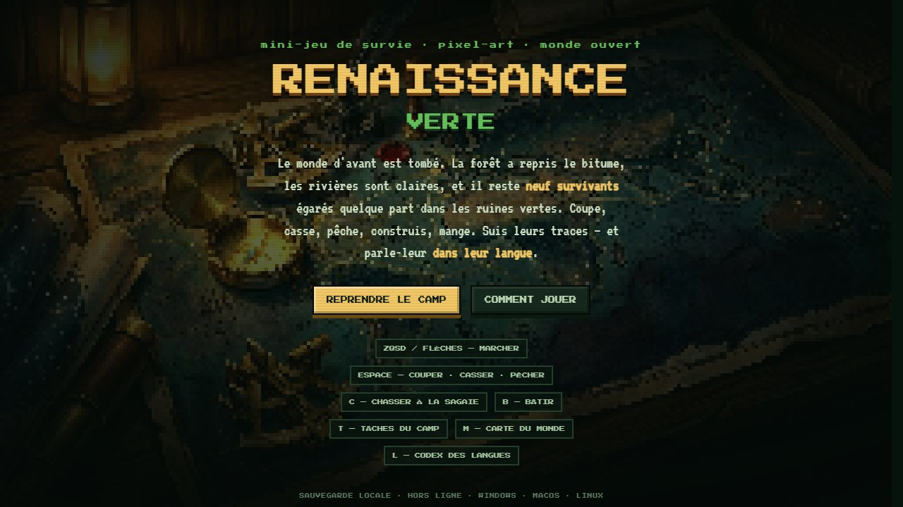</td>
<td width="50%"></td>
</tr>
<tr>
<td>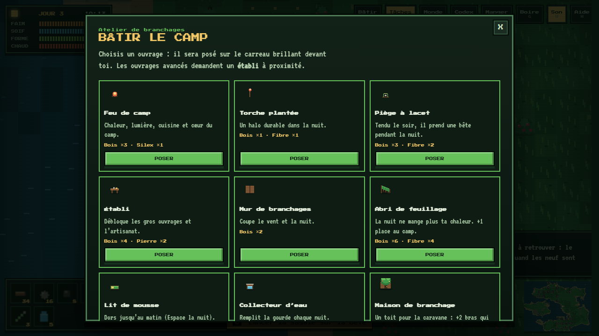</td>
<td>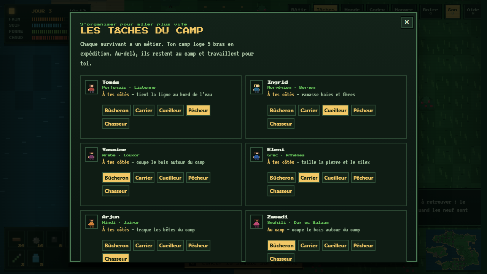</td>
</tr>
<tr>
<td>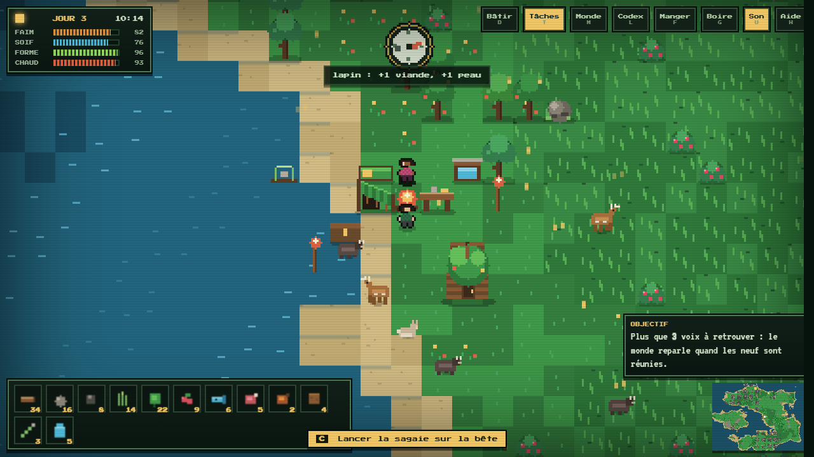</td>
<td>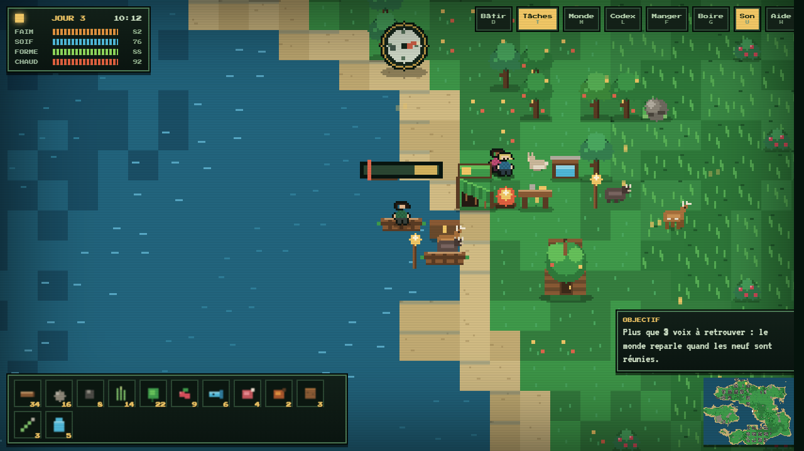</td>
</tr>
<tr>
<td>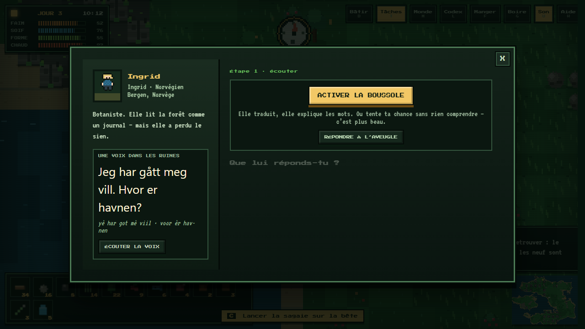</td>
<td>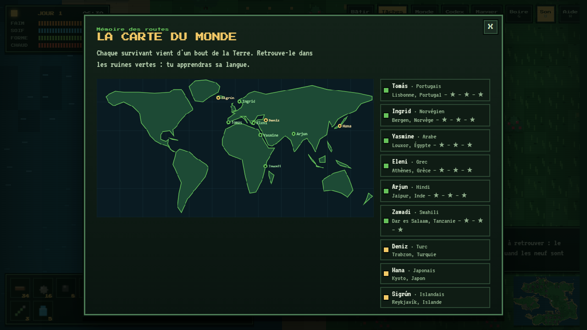</td>
</tr>
<tr>
<td>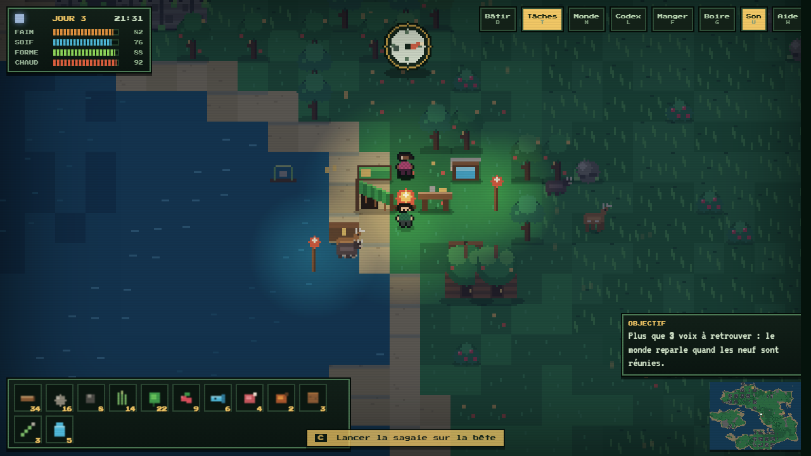</td>
<td></td>
</tr>
</table>

---

## ⌨️ Commandes

| Touche | Action | Bouton HUD |
|---|---|---|
| `↑ ↓ ← →` ou `Z Q S D` | marcher, nager, gouverner le radeau | croix tactile |
| `Espace` | couper · casser · cueillir · pêcher · monter ou accoster | **AGIR** |
| `C` | lancer la sagaie (visée automatique sur la bête la plus proche) | **Lancer** |
| `B` | ouvrir le chantier | **Construire** |
| `T` | répartir les tâches de la caravane | **Tâches** |
| `M` | carte du monde | **Carte** |
| `L` | carnet des langues | **Carnet** |
| `F` / `G` | manger le meilleur de la réserve / boire | **Manger** · **Boire** |
| `H` | aide-mémoire de survie | **Aide** |
| `U` | sons | **Son** |
| `Échap` | fermer un panneau, annuler un chantier | — |

---

## 🧪 Sous le capot

- **Un seul fichier** : `index.html` ≈ 2 600 lignes de HTML, CSS et JavaScript vanilla, polices comprises. Zéro build, zéro framework, zéro image externe, zéro appel réseau : les deux polices pixel (*Press Start 2P* de CodeMan38 et *VT323* de Peter Hull, Open Font License) sont embarquées en base64 dans le fichier. Débranche le Wi-Fi, le jeu tourne quand même.
- **Monde procédural** : bruit de valeur + `mulberry32` sur une graine, terrains et objets dans des `typed arrays`, rendu des carreaux sales uniquement (`dirty` map) et repousse de la végétation suivie par `regrowSet`.
- **IA de camp** : les ouvriers choisissent une cible atteignable, contournent les obstacles, mémorisent les carreaux bloquants, se téléportent s'ils restent coincés de l'autre côté d'un bras de mer.
- **Animaux sans entités** : 26 bêtes simulées dans une liste plate avec errance, fuite et file de réapparition — rien à sauvegarder d'autre qu'une position et une espèce.
- **Échelle pixel propre** : le canvas interne vaut la taille de la fenêtre divisée par 3 (par 2 sur petit écran), chaque pixel de jeu occupant 3 px à l'écran avec `image-rendering: pixelated` — net du 1366 × 768 au 4K, et jouable en portrait sur téléphone.

---

## 📁 Contenu du dépôt

```
index.html      le jeu, à lui tout seul
media/          captures d'écran et GIF (générés depuis le jeu, sans retouche)
assets/         image de vitrine
README.md       ce fichier
```

---

## 🛠️ Licence

Projet personnel de démonstration. Tu peux jouer, copier, t'amuser et t'en inspirer librement ; aucune licence formelle n'a encore été choisie pour la redistribution commerciale.
